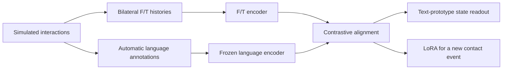

# Language-Grounded Force/Torque Pretraining for Extrinsic Contact Perception

Code accompanying our arXiv paper on learning physical-state representations from bilateral force/torque (F/T) histories using automatically generated language supervision in simulation.

**Paper:** arXiv link to be added.

**When should a robot stop descending during placement? When is a connector fully seated?** These events involve *extrinsic contact*: contact between a grasped object and its environment. F/T measurements carry this information, but also depend on object weight, grasp configuration, and motion. We study whether one pretrained F/T representation can support several physical-state readouts and adapt to a new contact event.

## Method and experiments

1. **Collect F/T in simulation.** Pick-and-place rollouts produce six-axis measurements at both gripper fingers: 12 channels, sampled at 100 Hz and grouped into 80-sample histories.
2. **Generate language annotations.** Simulator states provide action, weight, interaction, and support-condition labels that are converted into descriptions automatically.
3. **Align F/T histories with language.** Contrastive training maps F/T histories into a frozen Sentence-BERT language embedding space. Physical states can then be specified with text prototypes and read out using cosine similarity.



The paper uses **437,244 windows from 40,851 episodes and 892 training objects**, with physical-state readout evaluated on **75 unseen YCB objects**. Its two real-world demonstrations are:

- **Contact detection during placement:** transfer the simulation-pretrained encoder without updating its weights, using unlabeled calibration and Holding/Placing text-prototype similarity. A vertical-force sign-reversal rule is the experimental baseline.
- **Connector seating detection:** adapt to an event absent from pretraining using a small set of labeled episodes, and compare pretrained LoRA with the same architecture trained from scratch.

The paper link will be added when available. Experimental configurations and reproducibility notes are documented in the guides below.

## What is included

This repository contains the paper-related simulation and annotation pipeline, F/T encoders, contrastive training and evaluation, insertion adaptation, and research ROS 2 packages. Public upstream projects are pinned as Git submodules; our modifications are kept separately as source overlays.

**Datasets, checkpoints, recorded trials, photographs, and videos are not distributed through this GitHub repository.** A separate Hugging Face release is planned; no public artifact download is available from this repository yet. Until then, model training and paper-result reproduction require separately obtained data and checkpoints. The synthetic checks below do not require them.

## Quick start: code only

The reference platform is **Ubuntu 22.04, x86-64**, with Git and [uv](https://docs.astral.sh/uv/getting-started/installation/) installed.

```bash
git clone https://github.com/KawaharaLab/language-grounded-ft.git
cd language-grounded-ft

# Fetch only the required upstreams; avoid unrelated recursive Genesis assets.
git submodule update --init third_party/genesis third_party/patchtst

# Combine pinned upstream code with the research changes.
python3 tools/workspace.py materialize --without-robot

# Create the pinned Python 3.10 learning environment inside this repository.
tools/setup_env.sh learning

# Offline checks: synthetic F/T inputs, encoder outputs, and a tiny training step.
# Checks that need unpublished artifacts are skipped when those are absent.
python3 tools/run.py learning -- -m unittest discover \
  -s "$PWD/tests" -p 'test_learning_patchtst.py'
```

For the simulation environment and a synthetic contact-wrench check:

```bash
tools/setup_env.sh simulation
python3 tools/run.py simulation -- src/generation/smoke_cpu.py
```

The simulation smoke test builds a floor and a box on CPU; it needs no object dataset. The first run compiles simulator kernels. The pinned learning environment retains the original CUDA-enabled PyTorch dependencies, so its download is substantial even for CPU-only checks. Python environments and caches are kept under this repository; placing it on an SSD with sufficient free space is recommended.

## Attach local data and models

Artifacts stay outside Git and are accessed through symlinks, without copying their contents. Create a Git-ignored local configuration, for example `.local/artifacts.json`:

```json
{
  "links": [
    {
      "source": "/path/on/your/ssd/train_08142026",
      "destination": "artifacts/Genesis/data/train_08142026"
    },
    {
      "source": "/path/on/your/ssd/eval_08142026",
      "destination": "artifacts/Genesis/data/eval_08142026"
    }
  ]
}
```

```bash
python3 tools/link_local.py --config .local/artifacts.json            # validate
python3 tools/link_local.py --config .local/artifacts.json --execute  # attach
python3 tools/workspace.py doctor --without-robot
```

The complete [artifact layout](manifests/local-links.example.json) records the authors' local source paths and stable destination names. Replace `source` paths for your machine and keep only the entries required by your experiment. Do not run that example unchanged on a different machine. Dataset/model formats and required checkpoints are described in the guides below.

Linked directories are shared with their source locations. Save new results to `workspace/reproduced/` or another fresh output directory to preserve existing experiments.

## Run an experiment

| Task | Starting point | Additional inputs |
| --- | --- | --- |
| Generate and annotate simulated F/T episodes | [Simulation guide](docs/simulation.md#collect-one-episode) | Separately obtained object meshes |
| Train an F/T encoder and evaluate text-prototype readout | [Contrastive training and evaluation](docs/learning_patchtst.md#rq1-contrastive-training-and-fixed-prototype-evaluation) | Training windows, language embeddings, evaluation prototypes |
| Compare pretrained LoRA and end-to-end scratch for insertion | [Insertion adaptation](docs/learning_patchtst.md#primary-rq3-contrastive-lora-and-scratch-comparison) | Labeled insertion windows, split manifest, pretrained checkpoint |
| Replay the paper's supervised reference | [RQ1 replay](docs/learning_patchtst.md#authoritative-rq1-replay) | Archived reference checkpoints and evaluation artifacts |
| Run real-world placement acquisition and detection | [ROS setup](docs/robot-setup.md) and [robot experiments](docs/robot-reproduction.md) | ROS 2 Humble, matching hardware, calibration, model and prototypes |

For example, after attaching the required reference artifacts:

```bash
python3 tools/run.py learning -- "$PWD/env/learning-replay-rq1.py" \
  --workspace "$PWD/workspace" \
  --out "$PWD/workspace/reproduced/rq1_replay"
```

This command re-evaluates saved supervised-reference checkpoints; it does not train the contrastive model. The linked guide provides the separate training commands and paper configurations. Real-robot launch files use experimental settings that must be adapted to the installed cell; code-only checks do not command hardware.

The optional robot integration references an upstream driver with unresolved hardware/message licensing. Its experimental driver modifications are excluded from this public release, so exact hardware behavior needs separate integration; see the [robot setup boundary](docs/robot-setup.md). Simulation and learning do not require that driver.

## Repository layout

| Path | Purpose |
| --- | --- |
| `third_party/` | Pinned upstream Genesis, PatchTST, and Robotiq repositories |
| `research/genesis/` | Contact-wrench extension, collection, annotation, and evaluation changes |
| `research/patchtst/` | F/T encoders, contrastive learning, LoRA, and evaluation changes |
| `robot/` | Research ROS 2 packages and documented driver integration |
| `env/` | Pinned dependency locks and runtime setup |
| `tools/` | Workspace assembly, artifact linking, and release checks |
| `manifests/` | Source provenance, artifact layouts, and integrity records |
| `publication/` | Paper link and availability information |
| `workspace/`, `artifacts/`, `.venvs/`, `.cache/` | Generated/local-only content, excluded from Git |

Edit `research/` or `robot/`, then run the materialization command again (omit `--without-robot` for a configured robot workspace). Files in `workspace/` are generated and can be overwritten. The original upstream submodules remain unchanged.

## Reproducibility status

[Validation notes](docs/VALIDATION.md) distinguish completed checks from full experiment reproduction. Checks performed include synthetic encoder tests, a simulation contact-wrench test, annotation tests, saved-checkpoint replay, and ROS package builds. Full dataset collection and pretraining have not been rerun end to end in this consolidated workspace. Exact historical artifact versions, splits, and checkpoint choices matter; see the [experiment mapping](docs/EXPERIMENT_PATHS.md) and [reproducibility audit](docs/REPRODUCIBILITY_AUDIT.md).

## License and acknowledgments

Original research code and workspace tooling are released under **Apache-2.0**, except files carrying an existing component-specific license. This permits use, modification, and redistribution, including commercial use, under its terms. Upstream code keeps its own copyright and license notices; this repository does not relicense third-party components, object assets, models, or the manuscript.

We build on [Genesis](https://github.com/Genesis-Embodied-AI/Genesis), [PatchTST](https://github.com/yuqinie98/PatchTST), the [Robotiq ROS 2 driver](https://github.com/jannishaberhausen/robotiq_2f_gripper_ros2), and their dependencies. See [licensing scope](LICENSE.md) and [third-party notices](THIRD_PARTY_NOTICES.md) for component-specific terms and the robot-driver licensing boundary.
